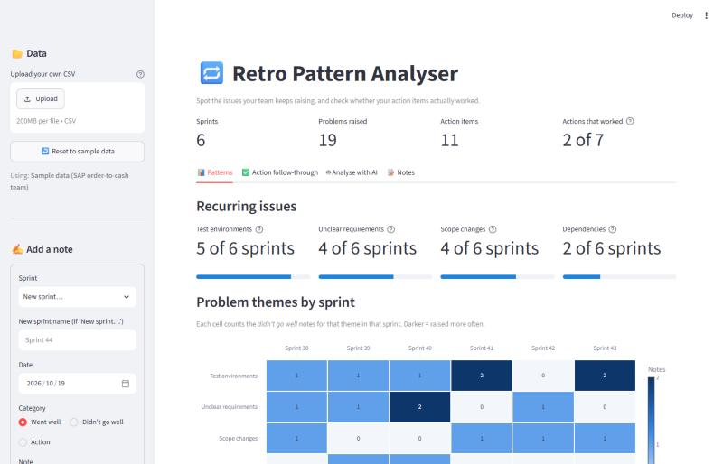
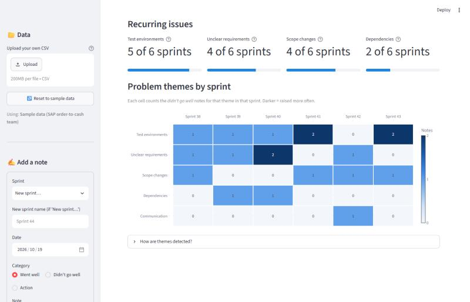
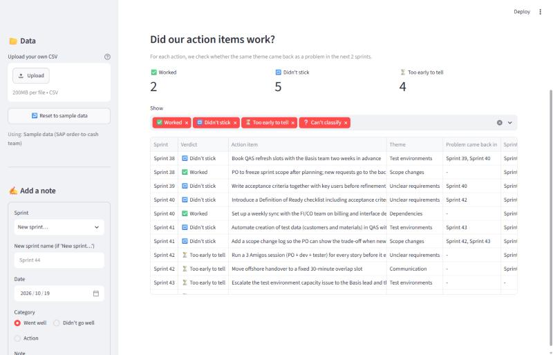
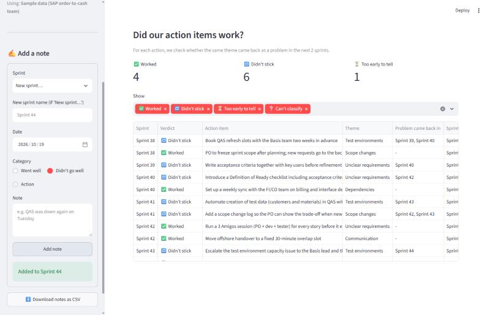
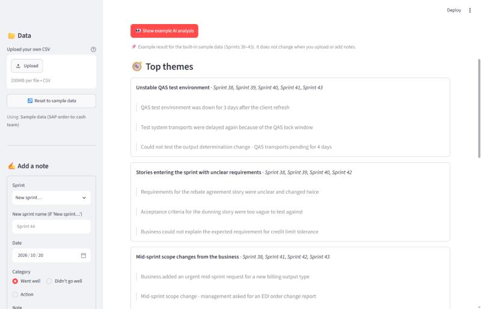
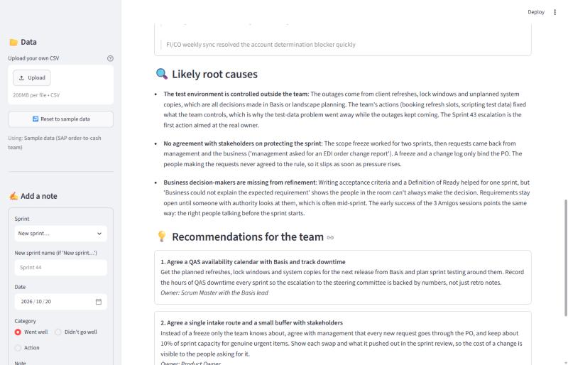

# 🔁 Retro Pattern Analyser

**Spot the issues your Scrum team keeps raising, and check whether your retro action items actually worked.**

Retrospective notes usually live in Miro boards or Confluence pages, one sprint at a time. The same problems come up again and again, and nobody checks whether last sprint's action items fixed anything. This app puts several sprints side by side so those patterns are easy to see.



---

## What it does

| Feature | What you get |
|---|---|
| 📂 **Load notes** | Read retro notes from a CSV, upload your own, or add notes in the app |
| 🟦 **Theme heatmap** | Themes × sprints, counting the *didn't go well* notes |
| 🔁 **Recurring issues** | e.g. *Test environments: 5 of 6 sprints* |
| ✅ **Action follow-through** | For each action: did the same theme come back in the next 2 sprints? → **Worked** / **Didn't stick** / **Too early to tell** |
| 🤖 **Analyse with AI** | Claude reads every note and returns the top themes (with quotes as evidence), likely root causes and 3 recommendations |

### Theme heatmap


### Action follow-through


### Add notes in the app
Add a note in the sidebar and every chart updates straight away. Below, a new *Sprint 44* test-environment note changed the Sprint 43 escalation action to **Didn't stick**.



### Analyse with AI
Claude picks out the top themes and backs each one with quotes from the notes…



…then explains the likely root causes and gives 3 recommendations, each with an owner.



> **Free demo mode:** without an API key, the tab shows **👀 Show example AI analysis**, which loads a prepared analysis of the sample data ([`data/sample_ai_analysis.json`](data/sample_ai_analysis.json)). Add a key to `.env` and the live **🤖 Analyse with AI** button appears, which analyses whatever notes are loaded.

---

## Setup (about 5 minutes)

**You need:** Python 3.10 or newer. An Anthropic API key from [console.anthropic.com](https://console.anthropic.com) is **optional**: without one, everything works and the AI tab runs in free demo mode. Live AI analysis is pay-as-you-go, usually a few cents per run.

```bash
# 1. Go into the project folder
cd retro-pattern-analyser

# 2. (Optional but recommended) create a virtual environment
python -m venv .venv
.venv\Scripts\activate          # Windows
# source .venv/bin/activate     # macOS / Linux

# 3. Install the libraries
pip install -r requirements.txt

# 4. (Optional) add your API key for live "Analyse with AI" - skip this for demo mode
copy .env.example .env          # Windows  (macOS/Linux: cp .env.example .env)
#    then open .env and replace your-api-key-here with your real key

# 5. Start the app
streamlit run app.py
```

The app opens at **http://localhost:8501**.

> 🔐 **Keep your key secret.** The key is only ever read from `.env`, never written in the code, and `.env` is listed in `.gitignore` so it won't be pushed to GitHub.

---

## Use your own retro notes

Make a CSV with these four columns:

| column | example | notes |
|---|---|---|
| `sprint` | `Sprint 44` | any name; sprints are sorted by date |
| `date` | `2026-07-27` | retro date, `YYYY-MM-DD` |
| `category` | `didnt_go_well` | one of `went_well`, `didnt_go_well`, `action` |
| `note` | `QAS was down for 2 days` | the sticky-note text |

Upload it from the sidebar. You can also add notes one at a time, then click **⬇️ Download notes as CSV** to keep them.

See [`data/sample_retro_notes.csv`](data/sample_retro_notes.csv) for a full example: an SAP order-to-cash team over Sprints 38–43, with recurring test environment delays, mid-sprint scope changes and unclear requirements.

---

## How it works (for learners)

The project has three Python files, and each one has a single job:

```
retro-pattern-analyser/
├── app.py              ← the screen: Streamlit widgets, tabs, the heatmap
├── analysis.py         ← the brain: themes, recurrence, follow-through (no UI code)
├── ai_analysis.py      ← the AI call: builds the prompt and talks to Claude
├── data/sample_retro_notes.csv
├── data/sample_ai_analysis.json  ← example AI result shown in demo mode
├── requirements.txt
└── .env.example        ← template for your API key
```

**1. Finding themes (`analysis.py → classify_theme`)**
Each note is checked against a keyword list, for example *"QAS", "transport", "test data"* → **Test environments**. The first theme that matches wins, and a note with no match goes to **Other**. It's simple and easy to explain, and you can change it by editing the `THEMES` dictionary.

**2. The heatmap (`theme_heatmap`)**
Keep only the *didn't go well* notes, then count them per theme and sprint with `pandas.crosstab`. That count table is the heatmap.

**3. Recurring issues (`recurring_issues`)**
For each theme, count how many sprints have at least one problem note. A theme that shows up in 2 or more sprints counts as recurring.

**4. Action follow-through (`action_follow_through`)**
For each action item:
- Find its theme, e.g. *"Book QAS refresh slots"* → Test environments
- Look at the **next 2 sprints**
- If the same theme came back as a problem → **🔁 Didn't stick**
- If 2 sprints have passed and it didn't come back → **✅ Worked**
- If fewer than 2 sprints have passed so far → **⏳ Too early to tell**

**5. The AI analysis (`ai_analysis.py`)**
All notes are grouped by sprint into one block of text and sent to Claude together with the follow-through results. The request uses **structured outputs**: the app gives Claude a Pydantic model (`RetroInsights`) describing the answer it wants (themes with quotes, root causes, recommendations), and the SDK hands back a typed Python object, so there's no messy text parsing. Model: `claude-opus-5-5`. A server-side fallback is switched on, so if the main model declines a request, the API retries it on a fallback model.

**6. Why `st.session_state`?**
Streamlit re-runs the whole script on every click. `st.session_state` is a small memory that survives those re-runs, which is why notes you add don't disappear.

---

## Ideas for next steps
- Let users edit theme keywords in the app instead of in code
- Use the AI to suggest themes for notes that land in **Other**
- Show a trend line of "problems per sprint" to see if retros are paying off
- Import straight from Miro or Confluence exports

---

*Built as a portfolio project by a Scrum Master who got tired of writing "test environment was down" on a sticky note every two weeks.*
